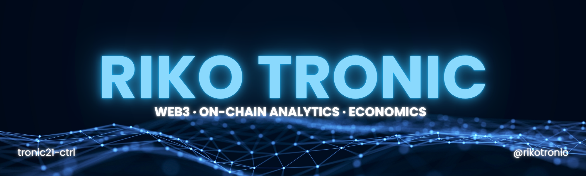
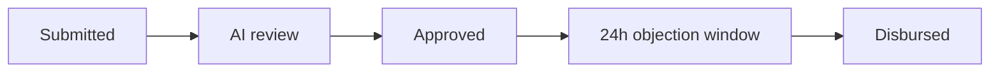

  

---

### Hi, I'm Riko

Self-directed Web3 developer from **Indonesia** with a background in **Development Economics**. I build on-chain tools that make money flows easy to check, combining economic thinking with smart contract engineering.

---

### What I Build

| Layer | Stack |
|---|---|
| **Frontend** | Next.js · React · Vite · wagmi · viem · Reown AppKit |
| **Smart Contracts** | Solidity · Foundry · Hardhat · OpenZeppelin |
| **Indexing** | Ponder · The Graph (Subgraph) · GraphQL |
| **Oracles** | Chainlink Price Feeds |
| **Decentralized AI** | 0G Compute (Qwen2.5 TEE) · 0G Storage |
| **Deployment** | Vercel · Railway · Sepolia · BNB Chain Testnet · Blockscout · BscScan |

---

### Featured Project: BanSOSChain

*A public audit trail for social aid disbursement in Indonesia.*

**[Live Dashboard](https://bansoschain.vercel.app)** · **[Repo](https://github.com/tronic21-ctrl/bansoschain)** · **[Demo Video](VIDEO_LINK)**

- Every step, from application to disbursement, is recorded on-chain and can be checked by anyone
- Ponder indexer feeding a bilingual (EN/ID) dashboard with BscScan links for each step
- AI-assisted eligibility check with human verifier review
- Recipient names are masked, and recipients are identified on-chain by an ID Hash

| Contract | Network | Verified on BscScan |
|---|---|---|
| BeneficiaryRegistry | BNB Chain Testnet | [REGISTRY_ADDRESS](https://testnet.bscscan.com/address/REGISTRY_ADDRESS#code) |
| DisbursementPool | BNB Chain Testnet | [POOL_ADDRESS](https://testnet.bscscan.com/address/POOL_ADDRESS#code) |

---

### Also Built: TronicLens

*On-chain intelligence for stakers who refuse to fly blind.*

**[Live Demo](https://troniclens.vercel.app)** · **[Repo](https://github.com/tronic21-ctrl/troniclens)**

- Real-time staking analytics: TVL, Whale Activity, Staker Distribution
- Live Chainlink ETH/USD price feed
- AI Insights via 0G Compute (Qwen2.5-7b, TEE verified)
- Subgraph-powered data on The Graph (tronic-staking)
- Snapshot storage on 0G Storage (Galileo Testnet)

---

### Projects

| Project | Description | Stack | Live |
|---|---|---|---|
| **BanSOSChain** | Public audit trail for social aid disbursement | Solidity · Foundry · Next.js · Ponder · BNB Chain Testnet | [↗](https://bansoschain.vercel.app) |
| **TronicLens** | On-chain analytics dashboard for DeFi staking | React · The Graph · Chainlink · 0G | [↗](https://troniclens.vercel.app) |
| **DeFi Dashboard** | Protocol analytics powered by the Dune API and custom SQL | React · Dune API | [↗](https://defi-dashboard-pi.vercel.app) |
| **Crypto Tracker** | Real-time crypto price tracker | React · Vite · REST API | [↗](https://crypto-tracker-pi-silk.vercel.app) |
| **foundry-troniclens** | Smart contract test suite for TronicLens | Foundry · Solidity | [↗](https://github.com/tronic21-ctrl/foundry-troniclens) |
| **solidity-contracts** | Collection of deployed Solidity contracts | Solidity · Sepolia | [↗](https://github.com/tronic21-ctrl/solidity-contracts) |

---

### GitHub Stats

---

### Tech Stack

---

### Connect with me

---

  

